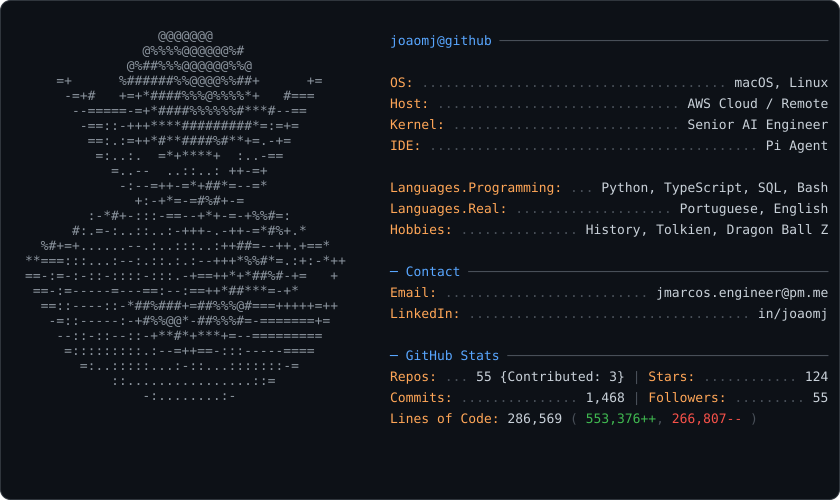

<picture>
  <source media="(prefers-color-scheme: dark)" srcset="dark_mode.svg">
  <source media="(prefers-color-scheme: light)" srcset="light_mode.svg">
  
</picture>

# Joao Marcos

**Senior AI Engineer** — agentic systems, retrieval-augmented generation, and cloud-native AI on AWS.

I build AI systems that survive production: retrieval over millions of scientific documents, agentic workflows on Bedrock, and the evaluations, observability, and guardrails that keep them honest long after the demo.

[LinkedIn](https://linkedin.com/in/joaomj) · [Email](mailto:jmarcos.engineer@pm.me)

## Selected work

**[pi-claude-directsdk](https://github.com/joaomj/pi-claude-directsdk)**: Use a Claude subscription as the model transport inside Pi without breaking Anthropic's terms of service. Pi keeps ownership of the transcript, tools, approvals, and retries; the unmodified Claude Code executable only supplies authentication. Published on npm with CI, release automation, and a qualified CLI version range. My most widely used open-source project.

**[imladris](https://github.com/joaomj/imladris)**: A local knowledge base for X bookmarks, the Brave reading list, and scholarly articles. It fetches, deduplicates, cross-references, and summarizes a week of reading, so the backlog stops compounding. Everything stays on the machine, with credentials in the system Keychain.

**[computer-cleanup-services](https://github.com/joaomj/computer-cleanup-services)**: Daily maintenance for Linux and macOS. Regenerable data is cleaned without a prompt; anything that could be application state never is. High-risk items are offered for review only when the machine is actually short of disk, memory, or swap, each answer is remembered, and every item is re-checked immediately before deletion — in use, recently modified, or tracked by Git means kept. Runs on systemd timers and launchd.

**[finrod](https://github.com/joaomj/finrod)**: A personal AI assistant that runs on a home server and talks through Telegram. One shared bot serves a separate Finrod for each person, with its own memory, history, and credentials. Models stay interchangeable, and memory stays in files the owner controls.

**[video-to-text](https://github.com/joaomj/video-to-text)**: A meeting recorder for Apple Silicon Macs. It captures the microphone and system audio, then writes a transcript with speaker labels and a separate summary. Transcription (MOSS-Transcribe-Diarize) and the summary (Qwen3.5-9B through llama-server) both run on the Mac, so no audio leaves the machine and there is no per-minute cost. One install script sets everything up, and one `meet` command records and processes.

Most of my production AI engineering work happens in private enterprise environments. The repositories above are what I build when nobody is paying me to; the rest are on [GitHub](https://github.com/joaomj).

## Who am I

I have a B.Sc. in Computer Science from UNESP, one of the best universities in Brazil and 6th in Latin America in the QS regional ranking. I started out in classical machine learning: recommendation systems, churn prediction, survival analysis, and predictive maintenance.

Since then my work has moved through data engineering, MLOps, and retrieval, and now agentic systems, in biotechnology, pharmaceutical research, media streaming, and financial services. What I enjoy is the same in every one of them: helping people make decisions based on evidence instead of gut feeling.

So modern AI never felt like a new subject to me. It is newer tools for the same job, which is giving a good answer when the information is incomplete.

Outside of work: I like to read about history, economics, and psychometrics, and I watch Dragon Ball Z (the Cell saga is my favorite!)

## What I believe

My default mindset is return on investment. I borrowed it from Operational Research: what are we trying to get, what limits us, and what does each option cost?

So before building something, I ask what it will give back and what it will cost to build and to keep running. What does this model cost per answer, and is the better one worth the difference? How do we know the retrieval is any good? If I can't put a number on it, I'm probably still guessing.

Underneath that is one conviction: truth is the most solid thing to hold on to, in any field. I would rather have a measured answer I don't like than a comfortable one I can't check.

## What I do

- **Agentic AI and RAG.** Retrieval pipelines over millions of documents: ingestion, chunking, hybrid search, reranking, context assembly, and source traceability. Agentic workflows with tool integration, MCP servers, orchestration, and human-in-the-loop checkpoints. Evaluation harnesses, LLM-as-a-judge scoring, and token cost and latency instrumentation. Tools: LangChain, LlamaIndex, LangGraph, Amazon Bedrock.
- **Cloud and data.** AWS (Bedrock, AgentCore, Lambda, Redshift, CloudWatch, S3, SageMaker), containerized services on Kubernetes, and REST APIs in front of them. Snowflake Cortex AI, dbt, Databricks, and PySpark for the data layer.
- **Engineering discipline.** GitHub Actions, release automation, and production monitoring. Prompt versioning, golden datasets, drift monitoring, and guardrails. Agent-assisted development built on reusable skills and commit hooks, so a system stays maintainable by someone other than its author.
- **Daily languages and wider toolkit.** Python, TypeScript, SQL, and Bash every day. Also GCP (BigQuery, Vertex AI), PyTorch, Hugging Face, scikit-learn, XGBoost, LightGBM, MLflow, survival analysis, recommendation systems, and learning-to-rank when the problem calls for them.

## Contact

Email or LinkedIn is the fastest way to reach me: [email](mailto:jmarcos.engineer@pm.me) · [LinkedIn](https://linkedin.com/in/joaomj).
